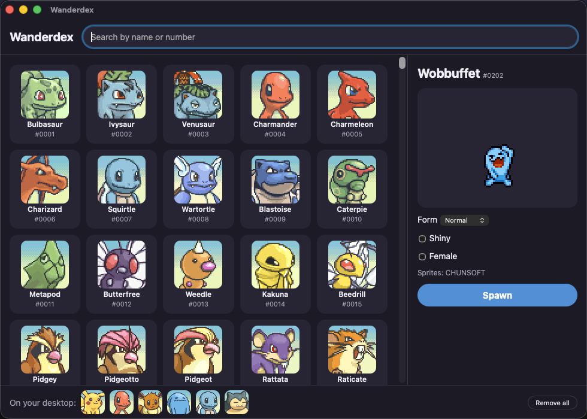

# Wanderdex

Pokémon that wander your desktop. Pick any of 976 Pokémon and it walks back and forth along the bottom
of your screen, naps, and shows off its moves while you work.

## What you can do

- **Bring any Pokémon to your desktop.** Search all 976 by name or number, including shiny, female and
  alternate forms where the sprites exist, and watch a live preview before you spawn.
- **Keep a whole team out at once.** Each pet walks, idles, naps and shows off its moves on its own.
- **Play with them.** Click a pet to make it do a move. Pick it up, drag it anywhere and let go:
  it falls back to the ground. Right-click for more.
- **Spread them across every monitor.** Pets walk along the bottom of whichever screen they're on,
  even with displays at different scales.
- **Pick up where you left off.** Your pets are still there after a restart, and Wanderdex can launch
  at login.
- **Stay out of the way.** It lives in the menu bar or system tray: change the size (2×, 3×, 4×) or hide every
  pet with one click. On macOS, clicks on the empty space around a pet go straight through to whatever is
  underneath.

## Quickstart

1. Download the latest build from [Releases](../../releases):
   - **macOS:** `Wanderdex_x.y.z_universal.dmg`
   - **Windows:** `Wanderdex_x.y.z_x64-setup.exe`
2. Install it and open it. Wanderdex appears in the menu bar (macOS) or system tray (Windows).
3. Click the icon → **Open picker**, search for a Pokémon, and press **Spawn**.

### First launch (unsigned app)

Wanderdex isn't code-signed, so your OS will warn you the first time:
- **macOS:** open the app, dismiss the warning, then go to **System Settings → Privacy & Security** and click **Open Anyway**.
  If macOS instead says the app "is damaged and can't be opened", run this once in Terminal, then open it again:
  `xattr -cr /Applications/Wanderdex.app`
- **Windows:** on the SmartScreen prompt, click **More info → Run anyway**.

## Using it

- Click the Wanderdex icon in the menu bar (macOS) or system tray (Windows) → **Open picker**.
- Search for a Pokémon, choose form / shiny / female if available, and press **Spawn**.
- Click a pet to make it do a move. Drag it around and drop it. Right-click for more.
- Tray menu: Size (2×/3×/4×), Hide all, Launch at login, Credits & license.

## Credits

Sprites: [PMD Sprite Repository (SpriteCollab)](https://github.com/PMDCollab/SpriteCollab), licensed
[CC BY-NC 4.0](https://creativecommons.org/licenses/by-nc/4.0/). Artist credits for every Pokémon you spawn
are shown in the app (tray → Credits & license). Sprites are downloaded at runtime and are not part of this repository.

Wanderdex is a non-commercial fan project. Pokémon is © Nintendo / Creatures Inc. / GAME FREAK inc.
Wanderdex is not affiliated with or endorsed by them.

## More

- **Build from source or contribute:** see [CONTRIBUTING.md](CONTRIBUTING.md).
- **Questions:** [Discussions](../../discussions). **Bugs and ideas:** [Issues](../../issues/new/choose).
- **Security:** see [SECURITY.md](SECURITY.md).
- **License:** code is [MIT](LICENSE). Sprites are CC BY-NC 4.0 (see Credits).
